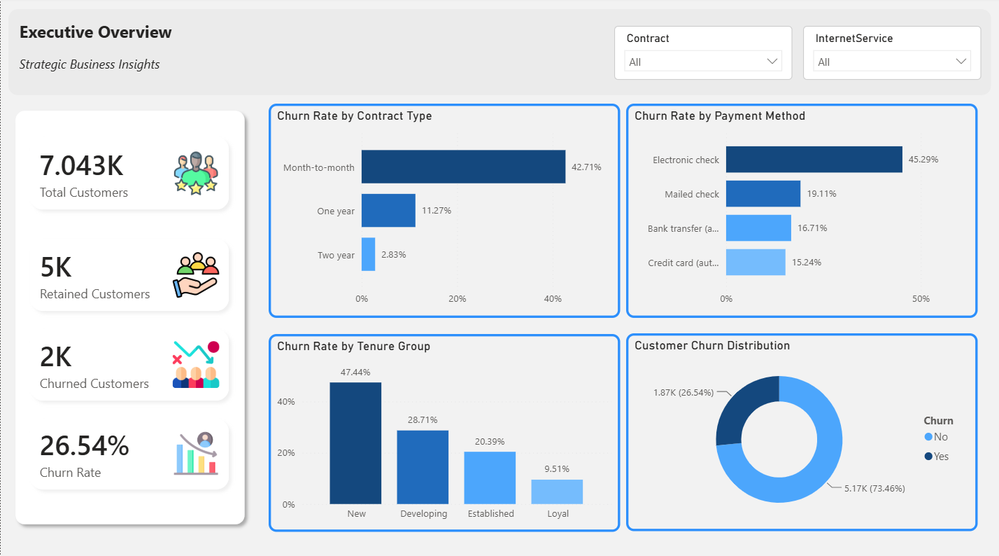
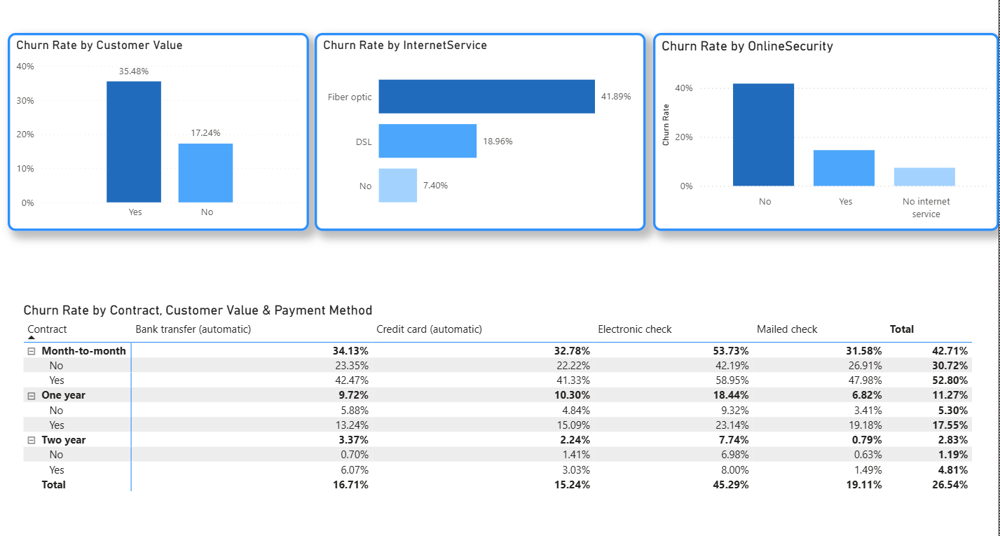
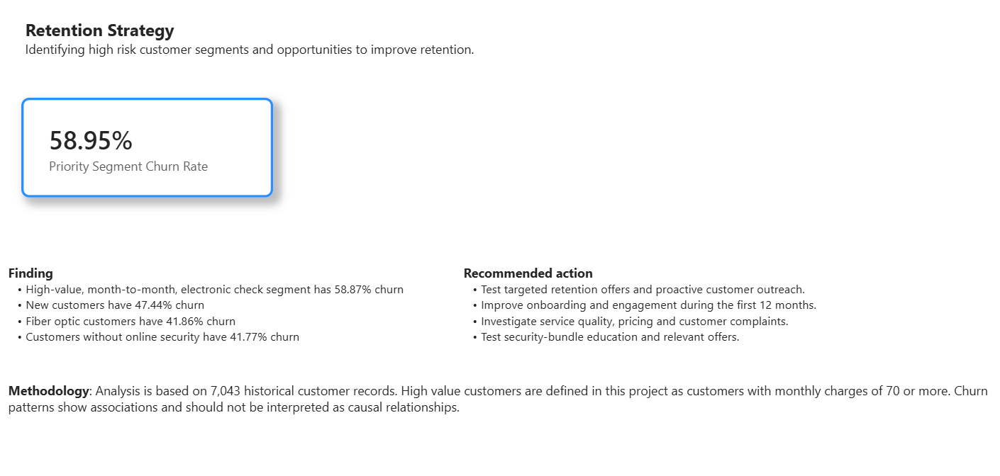

**Telecom Customer Churn & Retention Analytics**

Project Overview
An end-to-end data analytics project that aimed to learn about the churn patterns of the telecommunications company.
The project involves cleaning the customer data, exploratory analysis, identifying high-risk customer segments and providing data-driven retention recommendations using Excel, MySQL and Power BI.

Business Problem

A key issue for telecom companies is customer attrition. Knowing who the more at-risk customers are can aid businesses explore retention possibilities and enhance customer experience.

This project explores:
Overall Customer Churn Rate.
Patterns of churn by contract type.
- Trend in payment methods and internet service.
Customer value segmentation and tenure.
- Customer groups with relatively high churn rate.

Tools & Technologies:
Data cleaning, preparation and exploratory analysis using Microsoft Excel.
MySQL: SQL queries, aggregations, segmentation & analysis.
Power BI: Data modelling, DAX measures and interactive dashboards.

Project Workflow:
1. Cleaning and preparation of data in Excel.
Customer segmentation and exploratory analysis.
3. Analysis using MySQL SQL.
4. Data Modelling & DAX Calculations in Power BI.
5. Interactive dashboard development.
6. Business information, retention suggestions.

 Key Findings
- Overall churn rate: 26.54%.
- About 42.7% churn in month-to-month contracts.
- Electronic check payments: 22.2% churn.
- Fiber optic customers: 41.9% churn.
- Existing customers: An average of 30.9% churn.
- High value customers – around 35.5% churn.

Priority Customer Segment:
The combination of high-value customers, month-to-month contracts and electronic check payments showed approximately 58.95% historical churn.
This segment may be a focus for further investigation into retaining.

Power BI Dashboard:
The dashboard has 3 report pages:

1. Executive Overview: Overall customer KPIs and churn distribution.
2. Customer Churn Analysis: Churn patterns based on customer value, Internet Service, Online Security and Payment Method.
3. Retention Strategy: Priority customer groups, and recommended business actions.

Business Recommendations:
Explore focused retention strategies for high churn customer segments.
Enhance the first year induction and engagement.
- Research the customer experience and pricing of fiber optic customers.
Discuss customer engagement projects and service packages that are relevant.
- Test retention techniques in experiments.

Project Structure:
data/ — Cleaned customer dataset.
sql/ — SQL analysis queries.
dashboard/ — Power BI report and dashboard screenshots.
README.md — Project documentation.

Methodology & Limitations:
This analysis is based on 7,043 customer records from history.
This project's high value customers were those who paid a monthly fee of 70 or more.
The results are historical correlations and not causations or predictors of customer attrition.

Author
**Muhammad Ibrar Sohail**
IT Graduate | Aspiring Data Analyst | Excel | SQL | Power BI

## Dashboard Preview

### 1. Executive Overview

### 2. Customer Churn Analysis

### 3. Retention Strategy

